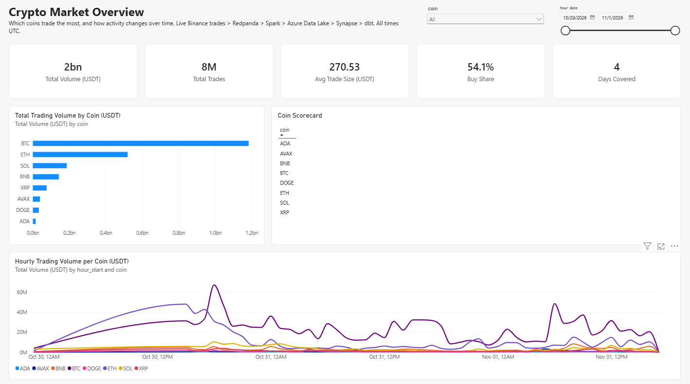
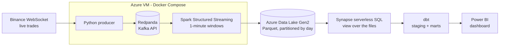
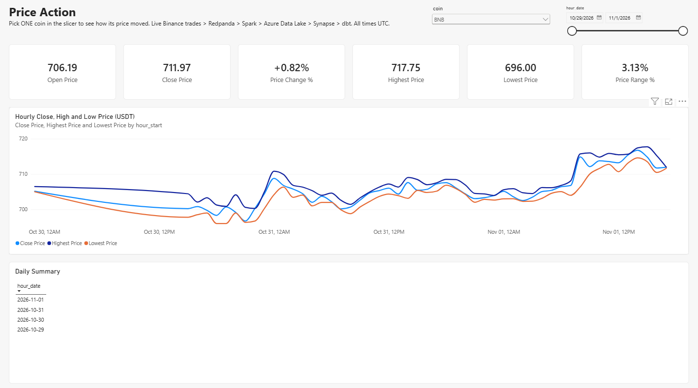
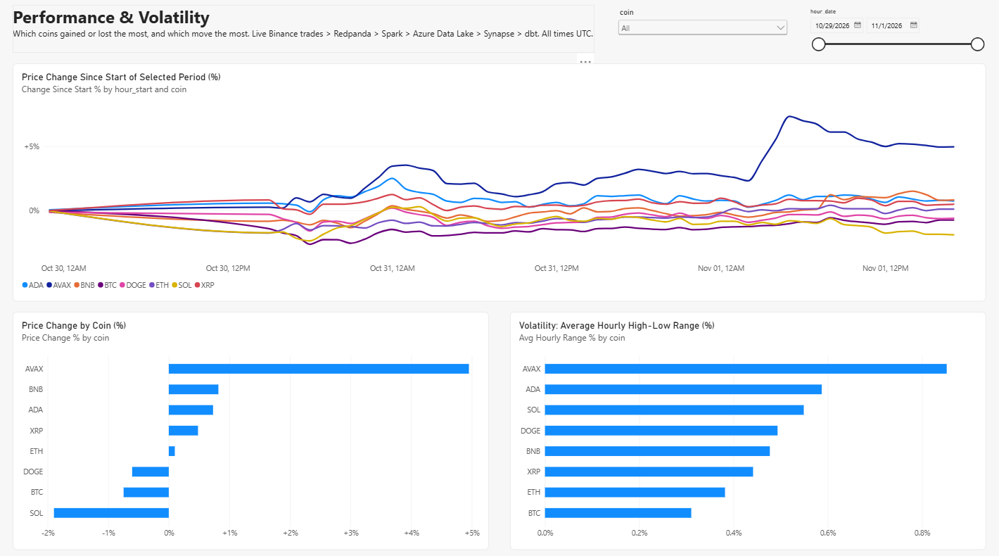
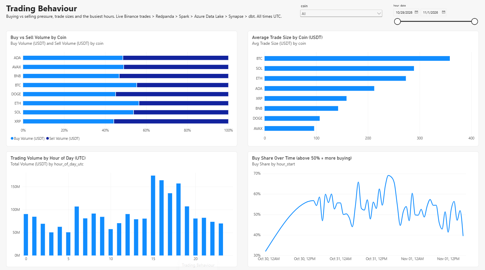
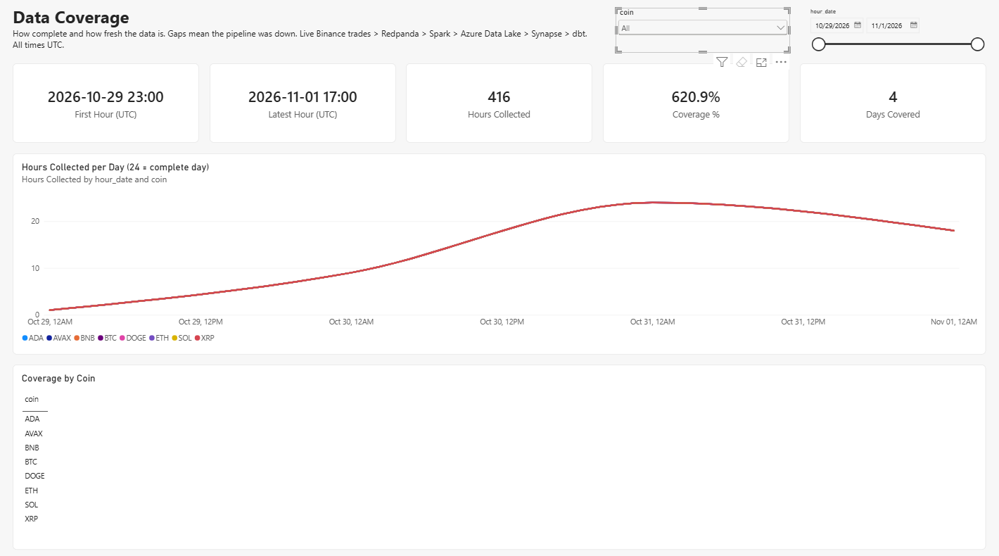

# Crypto Stream Analytics

A real-time data pipeline on Microsoft Azure that captures every live trade for 8 major
cryptocurrencies, turns them into 1-minute market data, and shows how the market behaves
in a Power BI dashboard.

Final project for the [Data Engineering Zoomcamp](https://github.com/DataTalksClub/data-engineering-zoomcamp).



**Dashboard:** open [`dashboard/crypto_dashboard.pbix`](dashboard/crypto_dashboard.pbix) in the
free [Power BI Desktop](https://www.microsoft.com/power-platform/products/power-bi/desktop).
It uses Import mode, so the data is inside the file and no Azure access is needed.

---

## Problem

Crypto exchanges publish every single trade as it happens. Binance alone produces about
**100 trades per second** for these 8 coins, around **8.8 million trades and 1.5 GB of raw
JSON per day**. In that form the data can't answer simple questions: Which coin is traded
most? Did the price go up or down today? Are buyers or sellers in control? When is the market
busiest? A stream also has no history: a trade that isn't captured the moment it happens is
gone.

This project captures the stream continuously, aggregates it into **1-minute candles**
(open, high, low, close, volume, trade count and buy/sell split per coin, about 11,520 rows
per day), stores them in a data lake, models them into analysis-ready tables with dbt, and
answers those questions in a dashboard.

## Architecture



| Stage | Job | Why it's a separate stage |
|---|---|---|
| Producer | **Collect** trades from Binance | Does nothing slow, so it never misses a trade |
| Redpanda | **Buffer** them | The producer and Spark can fail or restart independently without losing data |
| Spark | **Compute** 1-minute candles | Shrinks ~8.8M trades/day to ~11,520 rows/day |
| Data lake | **Store** Parquet files | Cheap, durable, the single source of truth |
| Synapse view | **Expose** the files as a SQL table | No loading step; new files appear in queries automatically |
| dbt | **Model** clean, tested tables | Version-controlled transformations with tests |
| Power BI | **Show** the answers | Interactive charts with coin and date filters |

The streaming part (producer, Redpanda, Spark) runs 24/7 on an Azure VM with Docker Compose.
All Azure infrastructure is created with Terraform.

## Tech Stack

| Layer | Tool |
|---|---|
| Cloud | Microsoft Azure |
| Infrastructure as code | Terraform (`azurerm ~> 4.0`) |
| Data source | Binance public market-data WebSocket |
| Message broker | Redpanda (Kafka-compatible) |
| Stream processing | Apache Spark Structured Streaming (PySpark 3.5.1) |
| Data lake | Azure Data Lake Storage Gen2 (Parquet) |
| Data warehouse | Azure Synapse Analytics, serverless SQL pool |
| Transformations | dbt (`dbt-synapse`) |
| Dashboard | Power BI |
| Containers | Docker, Docker Compose |

**Redpanda** is a Kafka-compatible message broker. It runs as a single container with no
ZooKeeper, and it uses the same Kafka API, so the producer and Spark code are exactly what
they would be with Apache Kafka.

**Azure Synapse serverless SQL pool** is the data warehouse (the course uses BigQuery). It
has no storage of its own: it queries the Parquet files in the lake directly, bills about
$5 per TB read, and costs nothing while idle.

## Dataset

[Binance public market-data WebSocket](https://developers.binance.com/docs/binance-spot-api-docs/web-socket-streams)
(`wss://data-stream.binance.vision`), using the `<symbol>@trade` stream for
BTC, ETH, SOL, BNB, XRP, DOGE, ADA and AVAX (all against USDT). It's free and needs no API key.

Each trade is cleaned by the producer and sent to Redpanda as:

| Field | Binance field | Type | Meaning |
|---|---|---|---|
| `trade_id` | `t` | long | Unique trade ID |
| `symbol` | `s` | string | Trading pair, e.g. `BTCUSDT` |
| `price` | `p` | double | Price in USDT (Binance sends it as text) |
| `quantity` | `q` | double | Amount of the coin traded |
| `trade_time` | `T` | long | When the trade happened (Unix ms): the event time |
| `side` | `m` | string | `buy` or `sell`: which side was the aggressor (`m` = buyer is maker → `sell`) |

## Stream Processing

[`streaming/stream_processor.py`](streaming/stream_processor.py) reads the topic and builds
**1-minute tumbling windows per coin** using **event time** (when the trade happened, not when
it arrived):

- **Watermark of 2 minutes:** a window is written once Spark is sure no more trades for it will
  arrive. Binance trades arrive within milliseconds, so this is generous.
- **Append mode, 1-minute trigger:** each finished candle is written exactly once, about once a minute.
- **Checkpoint in the data lake:** after a restart (or a move to a new machine), Spark resumes
  from the last processed Kafka offset instead of starting over.
- **Output:** Parquet files in `lake/trades_1min/trade_date=YYYY-MM-DD/`, one file per batch,
  timestamps in UTC.

## Data Warehouse Design

Spark writes 1-minute candles as Parquet files to Azure Data Lake Storage Gen2.
Synapse's serverless SQL pool queries those files in place: no data is loaded or
copied. [`warehouse/create_views.sql`](warehouse/create_views.sql) creates the view
`crypto_raw.trades_1min` over the files, and dbt and Power BI read from that view.
New files appear in queries automatically.

### Partitioned by `trade_date`

Spark writes one folder per day (`trades_1min/trade_date=2026-10-30/`). The view
reads `trade_date` from the folder name with `filepath(1)`, so a query that filters
on `trade_date` opens only the matching day folders (partition elimination). Every
dashboard chart filters by a date range, and serverless bills by the amount of data
read, so this makes queries both faster and cheaper.

### Why not also partition by coin

A `symbol=` folder level would let per-coin queries skip the other coins, but it
would create 8 times more files. Each one-minute batch already produces a small
file (about 8 rows, one per coin), and many small files slow serverless down more
than reading all coins of a day does. For the same reason, Spark writes one file
per batch (`coalesce(1)`) rather than one per Spark partition.

### Clustering

Serverless has no indexes, so its equivalent of clustering is how rows are laid
out in files. Each file holds the minute (or few minutes) that one batch finalized, so the files are already
clustered by time, which matches the main time-series chart. Text columns use the
`Latin1_General_100_BIN2_UTF8` collation, which lets filters on `symbol` be pushed
down into the Parquet reader.

### Why serverless instead of a dedicated SQL pool

A dedicated pool costs about $1–1.5 per hour even when idle. Serverless bills about
$5 per TB read, and this dataset is a few MB, so queries cost fractions of a cent.
At a much larger scale (billions of rows or many dashboard users), the better choice
would be loading into a dedicated pool, or compacting the small files once a day.

## Transformations (dbt)

The dbt project in [`dbt/`](dbt/) turns the raw view into dashboard-ready views in the
`crypto_analytics` schema. Every model is a **view**, because the serverless pool can't store
tables.

```
source: crypto_raw.trades_1min
            │
     stg_trades_1min
       │     │      │
  dim_coin   │   fct_daily_volume_by_coin
             │
     fct_hourly_market
```

| Model | Layer | What it does |
|---|---|---|
| `stg_trades_1min` | Staging | Removes duplicate minutes (a Spark restart can write a window twice), adds a readable `coin` (`BTC`) and a unique `candle_id`, renames columns |
| `fct_hourly_market` | Mart | Hourly open, high, low, close, volume and buy/sell volume per coin. Open and close come from the first and last minute of each hour |
| `fct_daily_volume_by_coin` | Mart | Daily volume, trade count and buy share per coin |
| `dim_coin` | Mart | One row per coin; Power BI links both fact tables to it, so one coin filter controls every chart |

**Tests (14):** `candle_id` is unique and not null, `coin` is one of the 8 expected values,
key columns are not null, and every coin in the fact tables exists in `dim_coin`.

**Serverless fix:** `dbt-synapse` replaces existing views with `RENAME OBJECT`, which only
dedicated pools support, so every re-run failed on serverless. A custom materialization,
[`dbt/macros/materializations/view.sql`](dbt/macros/materializations/view.sql), uses
`CREATE OR ALTER VIEW` instead.

## Dashboard

The Power BI report reads the three mart views in Import mode. Every page has a coin filter
and a date-range filter; all times are UTC.

| Page | Questions it answers |
|---|---|
| **Market Overview** | How big is the market? Which coin trades most, and what's its market share? How does activity change hour by hour? |
| **Price Action** | For one coin: did the price go up or down, and by how much? What were the highs and lows, day by day? |
| **Performance & Volatility** | Which coins gained or lost most? Which move the most? How do all coins compare on one % scale? |
| **Trading Behaviour** | Are buyers or sellers in control? Which coins attract big trades? What time of day is busiest? |
| **Data Coverage** | How much data is there, how fresh is it, and were there gaps when the pipeline was down? |

The two required tiles are the **volume by coin** bar chart (categorical) and the
**hourly volume per coin** line chart (over time), both on the Market Overview page.

### Market Overview


### Price Action



### Performance & Volatility



### Trading Behaviour



### Data Coverage



## Repository Structure

```
.
├── terraform/            Azure infrastructure (storage, Synapse, VM, network)
├── producer/             Binance WebSocket → Redpanda (Python, Dockerfile)
├── streaming/            Spark Structured Streaming job (PySpark, Dockerfile)
├── docker-compose.yml    Redpanda, topic setup, producer, Spark, Redpanda Console
├── warehouse/            Synapse serverless database objects (create_views.sql)
├── dbt/                  dbt project: sources, staging, marts, tests
├── dashboard/            Power BI report (.pbix) and page screenshots (images/)
└── .env.example          Every setting the project reads
```

## How to Run

Commands are for bash (Linux, macOS or WSL). PowerShell equivalents are noted where they differ.

### Prerequisites

- An Azure subscription where you can create a service principal and assign roles (Owner)
- [Azure CLI](https://learn.microsoft.com/cli/azure/install-azure-cli), [Terraform](https://developer.hashicorp.com/terraform/install) ≥ 1.6, Git
- Python 3.11+
- [sqlcmd](https://learn.microsoft.com/sql/tools/sqlcmd/sqlcmd-utility) and [ODBC Driver 18 for SQL Server](https://learn.microsoft.com/sql/connect/odbc/download-odbc-driver-for-sql-server)
- An SSH key at `~/.ssh/id_rsa.pub` (`ssh-keygen -t rsa -b 4096`)
- Power BI Desktop (Windows) to open the dashboard

> **Region:** Binance blocks US locations, so use a non-US Azure region. This project uses
> `southafricanorth`.

### 1. Clone and configure

```bash
git clone https://github.com/Phavour-EBEN/crypto-stream-analytics.git
cd crypto-stream-analytics
cp .env.example .env
```

Edit `.env`: pick globally unique names for `AZURE_STORAGE_ACCOUNT` (3–24 lowercase letters
and digits) and `SYNAPSE_WORKSPACE`, set `SYNAPSE_SQL_ENDPOINT` to
`<SYNAPSE_WORKSPACE>-ondemand.sql.azuresynapse.net`, and choose a `SYNAPSE_SQL_PASSWORD`
(8+ characters with upper and lower case, a digit and a symbol).

Load it into your shell (do this in every new terminal):

```bash
set -a; source .env; set +a
```

PowerShell:

```powershell
Get-Content .env | ForEach-Object { if ($_ -match '^\s*([A-Za-z_][A-Za-z0-9_]*)\s*=\s*(.*)$') { [Environment]::SetEnvironmentVariable($matches[1], $matches[2].Trim().Trim('"', "'"), 'Process') } }
```

### 2. One-time Azure setup (as the subscription owner)

```bash
az login
az account set --subscription "$AZURE_SUBSCRIPTION_ID"

# Resource group, and the resource providers the project uses
az group create -n "$AZURE_RESOURCE_GROUP" -l "$AZURE_LOCATION"
for p in Microsoft.Storage Microsoft.Synapse Microsoft.Compute Microsoft.Network; do
  az provider register --namespace "$p"
done

# Service principal that Terraform and Spark log in as; Contributor on this resource group only
az ad sp create-for-rbac --name crypto-pipeline --role Contributor \
  --scopes "/subscriptions/$AZURE_SUBSCRIPTION_ID/resourceGroups/$AZURE_RESOURCE_GROUP"
```

Copy `tenant`, `appId` and `password` from the output into `.env` as `AZURE_TENANT_ID`,
`AZURE_CLIENT_ID` and `AZURE_CLIENT_SECRET`, then reload `.env`.

### 3. Create the infrastructure (Terraform)

```bash
export TF_VAR_subscription_id=$AZURE_SUBSCRIPTION_ID
export TF_VAR_tenant_id=$AZURE_TENANT_ID
export TF_VAR_client_id=$AZURE_CLIENT_ID
export TF_VAR_client_secret=$AZURE_CLIENT_SECRET
export TF_VAR_resource_group_name=$AZURE_RESOURCE_GROUP
export TF_VAR_location=$AZURE_LOCATION
export TF_VAR_storage_account_name=$AZURE_STORAGE_ACCOUNT
export TF_VAR_synapse_workspace_name=$SYNAPSE_WORKSPACE
export TF_VAR_sql_admin_user=$SYNAPSE_SQL_USER
export TF_VAR_sql_admin_password=$SYNAPSE_SQL_PASSWORD
export TF_VAR_client_ip=$(curl -s https://api.ipify.org)   # your IP: allowed to SSH and to reach Synapse

terraform -chdir=terraform init
terraform -chdir=terraform plan
terraform -chdir=terraform apply
```

This creates the storage account (Data Lake Gen2) with `lake` and `synapse` containers, the
Synapse workspace and its firewall rules, and the VM with its network and SSH-only firewall.
The Synapse workspace takes 5–10 minutes.

> **If your IP changes** (home internet often does), SSH and Synapse connections time out.
> Set `TF_VAR_client_ip` again and re-run `terraform apply`.

### 4. Grant data access (as the subscription owner)

The service principal is only a Contributor, which can't assign roles, so these run once as you:

```bash
STORAGE_ID=$(terraform -chdir=terraform output -raw storage_account_id)
SYNAPSE_MI=$(terraform -chdir=terraform output -raw synapse_principal_id)

# Spark writes to the lake as the service principal
az role assignment create --assignee "$AZURE_CLIENT_ID" \
  --role "Storage Blob Data Contributor" --scope "$STORAGE_ID"

# Synapse serverless reads the lake as its managed identity
az role assignment create --assignee-object-id "$SYNAPSE_MI" --assignee-principal-type ServicePrincipal \
  --role "Storage Blob Data Contributor" --scope "$STORAGE_ID"
```

Optional, to use Synapse Studio in the browser with your own account (the service principal
created the workspace, so it is the only Synapse admin):

```bash
ME=$(az ad signed-in-user show --query id -o tsv)
az login --service-principal -u "$AZURE_CLIENT_ID" -p "$AZURE_CLIENT_SECRET" --tenant "$AZURE_TENANT_ID"
az synapse role assignment create --workspace-name "$SYNAPSE_WORKSPACE" \
  --role "Synapse Administrator" --assignee-object-id "$ME" --assignee-principal-type User
az login   # back to your own account
```

### 5. Start the streaming pipeline on the VM

```bash
VM_IP=$(terraform -chdir=terraform output -raw vm_public_ip)
ssh azureuser@$VM_IP
```

On the VM:

```bash
sudo apt-get update && sudo apt-get install -y git
curl -fsSL https://get.docker.com | sudo sh
sudo usermod -aG docker $USER
exit
```

Copy `.env` to the VM (it's not in Git), then start everything:

```bash
ssh azureuser@$VM_IP "git clone https://github.com/Phavour-EBEN/crypto-stream-analytics.git"
scp .env azureuser@$VM_IP:~/crypto-stream-analytics/.env
ssh azureuser@$VM_IP
```

```bash
cd crypto-stream-analytics
chmod 600 .env
docker compose up -d --build
docker compose ps                    # all Up; redpanda-init Exited (0)
docker compose logs -f producer      # "Sent N trades"
```

After about 3 minutes, `docker compose logs spark | grep batch` shows one line per batch.
Every service has `restart: unless-stopped`, so the pipeline survives a VM reboot.

To view the Redpanda Console (port 8080) and Spark UI (port 4040) without opening them to the
internet, use an SSH tunnel from your machine:

```bash
ssh -L 8080:localhost:8080 -L 4040:localhost:4040 azureuser@$VM_IP
```

> To try the pipeline locally instead of on the VM, run `docker compose up -d --build` on your
> own machine. Don't run both at once: they would share the same lake folder and checkpoint.

### 6. Check data is arriving in the lake

```bash
az storage fs file list --account-name "$AZURE_STORAGE_ACCOUNT" -f lake \
  --path trades_1min --recursive false --auth-mode login -o table
```

A `trade_date=YYYY-MM-DD` folder appears, with a new Parquet file about every minute.
Let the pipeline run for a few days so the dashboard has history.

### 7. Create the Synapse database and views

```bash
sqlcmd -S "$SYNAPSE_SQL_ENDPOINT" -d master -U "$SYNAPSE_SQL_USER" -P "$SYNAPSE_SQL_PASSWORD" \
  -Q "CREATE DATABASE $SYNAPSE_DATABASE COLLATE Latin1_General_100_BIN2_UTF8"

read -s -p "New master key password: " MASTER_KEY; echo
sqlcmd -S "$SYNAPSE_SQL_ENDPOINT" -d "$SYNAPSE_DATABASE" -U "$SYNAPSE_SQL_USER" -P "$SYNAPSE_SQL_PASSWORD" \
  -v STORAGE_ACCOUNT="$AZURE_STORAGE_ACCOUNT" -v MASTER_KEY_PASSWORD="$MASTER_KEY" \
  -i warehouse/create_views.sql
```

The master key password is new: you choose it here (8+ characters, mixed case, digit, symbol).
It encrypts the credential Synapse uses to read the lake. Check the view:

```bash
sqlcmd -S "$SYNAPSE_SQL_ENDPOINT" -d "$SYNAPSE_DATABASE" -U "$SYNAPSE_SQL_USER" -P "$SYNAPSE_SQL_PASSWORD" \
  -Q "SELECT symbol, COUNT(*) AS minutes, SUM(quote_volume) AS volume_usdt FROM crypto_raw.trades_1min GROUP BY symbol ORDER BY volume_usdt DESC"
```

### 8. Run dbt

```bash
python -m venv .venv && source .venv/bin/activate     # PowerShell: .\.venv\Scripts\Activate.ps1
pip install "dbt-synapse==1.8.5"

cd dbt
cp profiles.yml.example profiles.yml                 # reads every value from .env
dbt debug --profiles-dir .                           # "All checks passed!"
dbt build --profiles-dir .                           # 4 views + 14 tests: PASS=18
cd ..
```

Optional: `dbt docs generate --profiles-dir . && dbt docs serve --profiles-dir .` shows the
lineage graph.

### 9. Open the dashboard

Open `dashboard/crypto_dashboard.pbix` in Power BI Desktop. It already contains data.

To refresh it with your own data, go to **Transform data → Data source settings →
Change Source**, change the server to your `SYNAPSE_SQL_ENDPOINT`,
sign in with **Database** credentials (`SYNAPSE_SQL_USER` / `SYNAPSE_SQL_PASSWORD`), and click
**Refresh**.

### Teardown

To pause (keeps all data; the VM stops billing for compute):

```bash
az vm deallocate -g "$AZURE_RESOURCE_GROUP" -n crypto-stream-vm
```

To delete everything:

```bash
terraform -chdir=terraform destroy
az ad sp delete --id "$AZURE_CLIENT_ID"
az group delete -n "$AZURE_RESOURCE_GROUP"
```

## Cost

| Resource | Cost |
|---|---|
| VM `Standard_D2s_v5` | The main cost, about $0.10/hour while running; nothing while deallocated (except its disk) |
| Data lake | A few cents per month: candles are a few MB per day |
| Synapse serverless | About $5 per TB read; this dataset costs fractions of a cent per query |
| Redpanda, Spark, dbt | Free (open source, running on the VM or your machine) |

## Limitations and Future Work

- **Small files:** streaming writes one small Parquet file per minute. A daily compaction job
  would make queries faster as history grows.
- **Views only:** dbt models are views, recomputed on every read. That's fine at this size;
  at a larger scale they would become tables in a dedicated pool.
- **Manual refresh:** the dashboard is an Import-mode snapshot. Refresh could be scheduled
  with Kestra, Airflow or Azure Data Factory.
- **SQL authentication:** dbt and Power BI use the SQL admin login instead of Microsoft Entra ID.
- **Single machine:** Redpanda and Spark run on one VM. A managed service (Event Hubs with the
  Kafka API, or Databricks) would add high availability.
- **Role assignments by hand:** the service principal can't assign roles, so step 4 is manual
  instead of in Terraform.
- **No CI:** a GitHub Actions workflow could run `terraform validate`, `dbt build` and lint checks.
